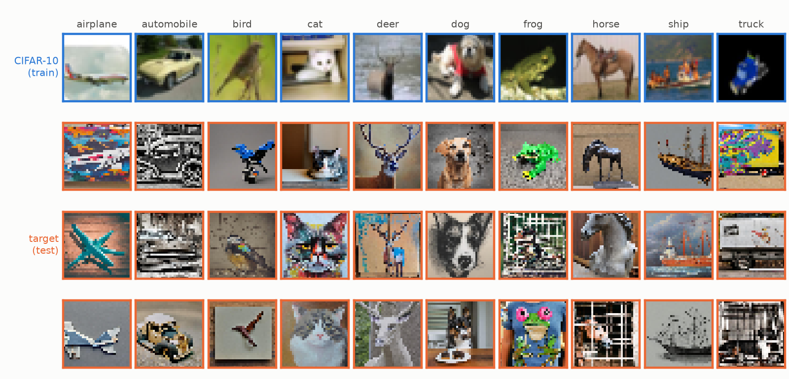
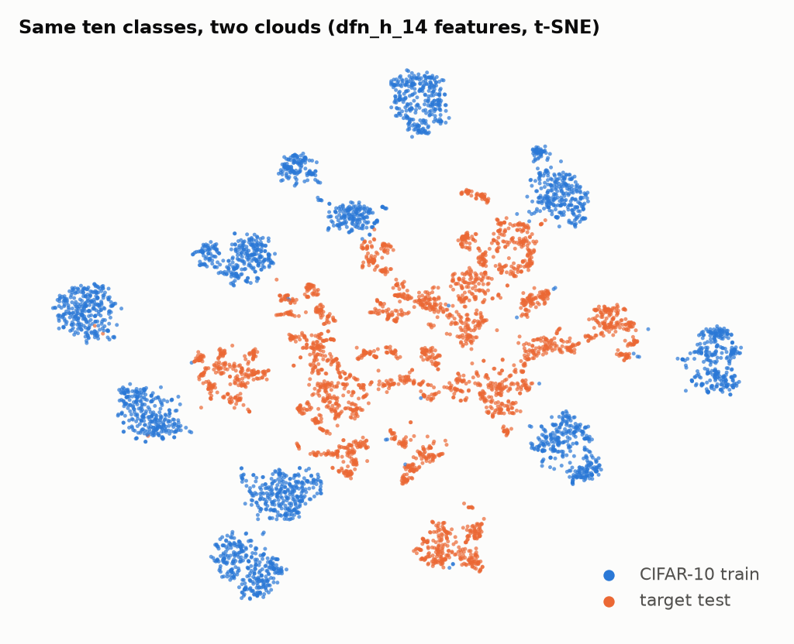
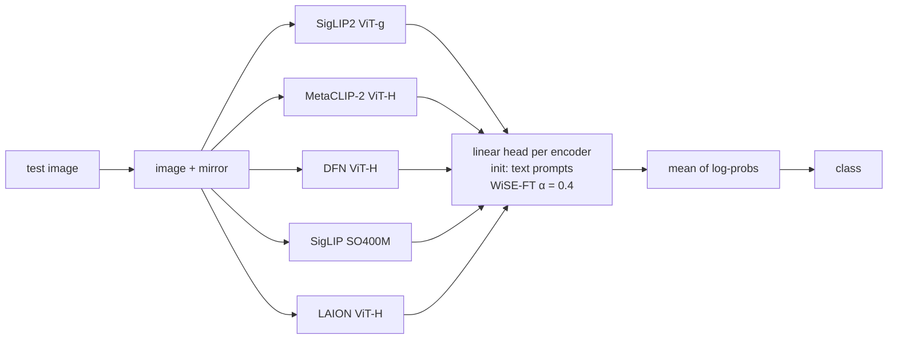
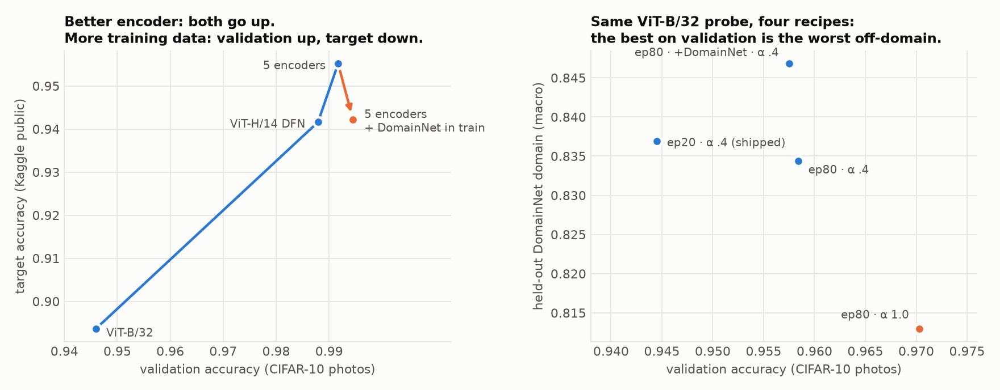
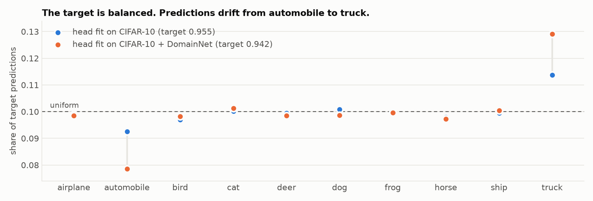

# CIFAR-10 under distribution shift

RecVis 2026 (MVA), assignment 3. Train and validation are the usual CIFAR-10 photos. The test set isn't.

**0.955** on the hidden target with five frozen vision-language encoders and a linear head, each test image classified on its own. One page write-up in [`report/report.pdf`](report/report.pdf).



*Top row: one CIFAR-10 training photo per class. Below: target images the final model put in that class. Toys, Lego, embroidery, pixel art, line drawings, Stable Diffusion renders.*

## The shift

The test split comes from CIFAR-10-Warehouse (Sun et al., ICLR 2024): the same ten classes, re-collected from image search engines with colour and style variants, plus a set generated by Stable Diffusion 2.1. The labels mean the same thing. The pixels don't.

You can see how big the gap is without any labels. Embed 3,000 train and 3,000 test images with a frozen CLIP encoder and fit a logistic regression to tell them apart: it gets **99.7%** (5-fold). In a t-SNE the source forms ten tight class clusters and the target sits in its own cloud in the middle.



This is the part that decides everything else. For a target risk you get roughly

```
R_target(h)  ≤  R_source(h)  +  divergence(φ(source), φ(target))  +  λ
```

(Ben-David et al., 2010). 50k labelled photos push the first term down. They do nothing to the second one, which depends on the representation φ only. So:

- **no training from scratch**: a ResNet fit on CIFAR-10 learns a φ for photos and the divergence term is free to blow up;
- **freeze a big pretrained encoder** whose corpus already has drawings, toys and renders of the same nouns, and only fit a small head on top.

## What I built



1. Each encoder embeds the image and its horizontal flip, averaged.
2. The head for each class starts at the text embedding averaged over 39 prompts, 32 of which name a rendition style ("a lego {}", "an origami {}", "pixel art of a {}"...).
3. It's fitted on the 50k CIFAR-10 features for 20 epochs (LP-FT), then pulled back towards the zero-shot head with α = 0.4 (WiSE-FT).
4. The five encoders are pooled as a product of experts. They were trained on five different corpora, so their mistakes don't line up.

Features are cached once on a GPU, after that every experiment runs on a laptop in seconds.

## Results

| head fitted on | encoders | validation | target |
|---|---|---|---|
| CIFAR-10, ViT-B/32 | 1 | 0.9460 | 0.8937 |
| CIFAR-10, ViT-H/14 DFN | 1 | 0.9879 | 0.9416 |
| **CIFAR-10** | **5** | **0.9917** | **0.9552** |
| CIFAR-10 + DomainNet | 5 | 0.9945 | 0.9422 |

## Validation is measured on the wrong distribution

The most useful thing I learned here. Validation is 10k more CIFAR-10 photos, so it tells you about the source and nothing else.



**Changing the encoder** moves validation and target together. Bigger and more diverse pretraining helps everywhere.

**Changing how the head is fitted** breaks that link. Two times it cost me a submission:

- Training the probe longer (80 epochs instead of 20) gave +0.0025 on validation and +0.015 on a corruption-based proxy I had built. On the target: **−0.0068**. The proxy was made from validation images, so it measured robustness to noise, not to a new image distribution.
- Adding DomainNet clipart and sketch to the training set gave +0.013 on a held-out DomainNet domain (leave-one-domain-out, so a proper off-domain test). On the target: **−0.013**, 1040 images broken for 379 fixed. Renditions are a direction of shift, and clipart isn't the direction a search engine takes.

The right panel is the same story on a small encoder: the recipe with the best validation score is the worst one off-domain.

The predicted class balance gave it away before the leaderboard did. The target is balanced, and the DomainNet head starts sending automobiles to truck:



## Things that didn't make it

- **Transduction.** Sinkhorn balancing, label propagation and a Laplacian max-margin over the whole test set reached 0.964. The course rule is one test image at a time, so none of it is in the final model.
- **Generated validation set.** An SDXL-Turbo rendition split came out *easier* than CIFAR-10 (0.990 zero-shot vs 0.939). Useless for ranking anything.
- **Label-free model selection.** 18 unsupervised criteria checked by rank correlation against true accuracy. The only one that held was circular.

## Running it

```bash
pip install -r requirements.txt
export RECVIS_DATA_DIR=/path/to/competition/npz   # train.npz, validation.npz, test.npz, sample_submission.csv
python main.py
```

The first run downloads the five checkpoints (~12 GB) and extracts features, about four hours on a T4. Features are cached as float16 under `RECVIS_CACHE_DIR` (default `./cache`). After that `python main.py --cached-only` takes seconds and never touches the network.

Figures: `python scripts/make_figures.py --predictions runs/submission.csv`.

```
main.py              end to end: features → heads → ensemble → submission.csv
recvis/config.py     paths, class names, the 39 prompts
recvis/backbones.py  the five open_clip checkpoints, zero-shot head
recvis/features.py   extraction + float16 cache
recvis/heads.py      linear head, LP-FT, WiSE-FT
scripts/             README figures
```

## References

- Ben-David et al., *A theory of learning from different domains*, Machine Learning 2010
- Radford et al., *CLIP*, ICML 2021
- Kumar et al., *Fine-tuning can distort pretrained features* (LP-FT), ICLR 2022
- Wortsman et al., *Robust fine-tuning of zero-shot models* (WiSE-FT), CVPR 2022
- Peng et al., *Moment matching for multi-source domain adaptation* (DomainNet), ICCV 2019
- Sun et al., *CIFAR-10-Warehouse*, ICLR 2024

Starter code and CIFAR-10 data from the RecVis course. MIT licence.
